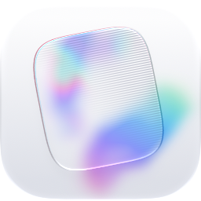
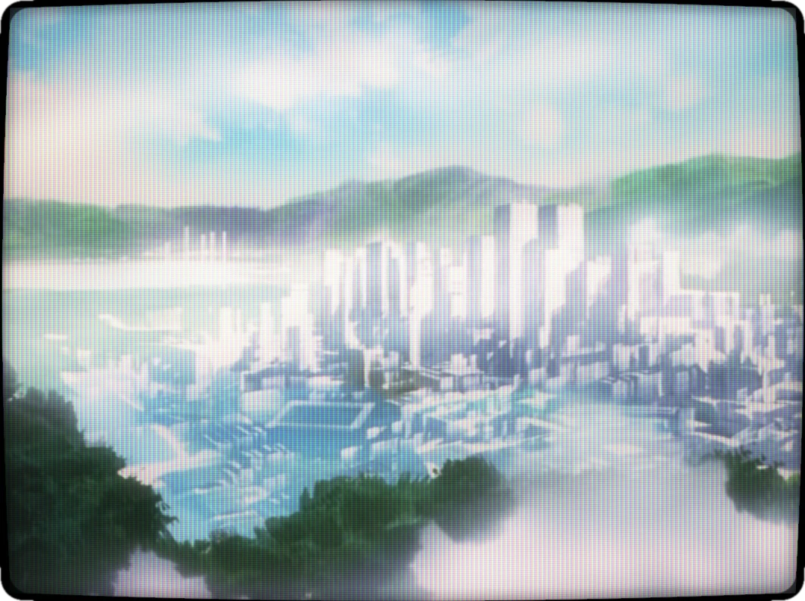
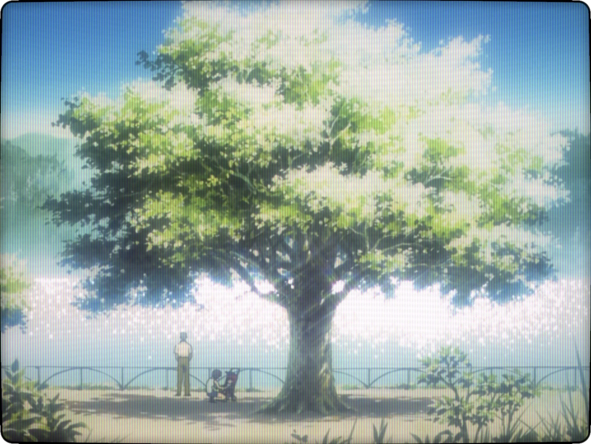
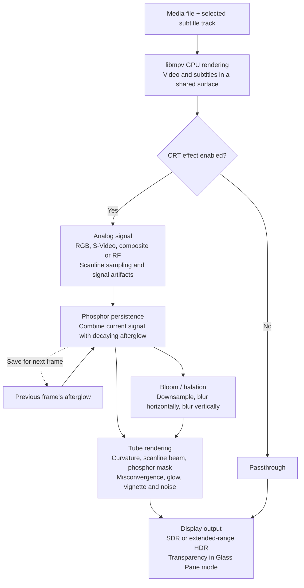

<p align="center">
  <picture>
    <source media="(prefers-color-scheme: dark)" srcset="docs/icon-dark.png">
    
  </picture>
</p>

<h1 align="center">CRT Player</h1>

<p align="center">
  A minimal macOS video player, styled after QuickTime Player, that shows every
  frame through a simulated cathode-ray tube.
</p>

<p align="center">
  
  
</p>

## Contents

- [Features](#features)
- [Requirements](#requirements)
- [Getting started](#getting-started)
- [Using CRT Player](#using-crt-player)
- [Keyboard shortcuts](#keyboard-shortcuts)
- [Development](#development)
- [How the simulation works](#how-the-simulation-works)
- [Project layout](#project-layout)

## Features

**Playback**

- Plays MKV, MP4, MOV, and any other video or audio format libmpv supports,
  with hardware decoding where available.
- Switches between embedded audio tracks without restarting playback.
- Shows embedded or external subtitles (SRT, ASS/SSA, WebVTT, bitmap), drawn
  into the picture *before* the CRT effect, so they look like part of the
  broadcast. Works on audio-only files too.

**CRT simulation**

- Multi-pass Metal shader with:
  - **Video signal:** RGB, S-Video, composite (with dot crawl and rainbowing),
    or RF (with ghosting and snow)
  - **Beam:** Gaussian scanlines that widen with brightness
  - **Phosphors:** aperture grille, shadow mask, or slot mask
  - **Tube:** curved faceplate with rounded corners, halation, bezel glow
  - **Imperfections:** phosphor persistence, misconvergence, hum bar, grain
- **Presets:** Classic (default), Studio Monitor, Living Room TV, Arcade
  Cabinet, Green Terminal, and Amber Terminal. Every parameter is adjustable.
- **HDR output:** on displays with extended dynamic range, lit phosphors go
  brighter than SDR white, so the mask and scanlines don't dim the picture.
- **Picture-tube transitions:** windows power on and off like a CRT, and
  switching presets cuts through a burst of static. With no picture yet, the
  screen shows analog snow.

**Window**

- Edge-to-edge video under a transparent title bar. The title bar and floating
  Liquid Glass control bar fade out during playback.
- Drag an empty area of the control bar to move it anywhere in the window.
- **Glass Pane** (⌥⌘G): the window becomes a Liquid Glass pane and the picture
  becomes light on it. The desktop shows through dark parts of the video, the
  scanline gaps, and the corners outside the tube.
- **Float on Top** (⌥⌘T): keeps the player above other apps' windows.

## Requirements

- macOS 26 or later
- Xcode 26 or later
- [Homebrew](https://brew.sh) packages `mpv` and `pkg-config` (build time only)

## Getting started

```sh
brew install mpv pkg-config
make install
```

This builds `CRT Player.app` and copies it to `/Applications`. The playback
libraries are bundled into the app, so it doesn't need Homebrew at runtime.

To try it without installing:

```sh
make run    # build and open the app
make demo   # build and open a bundled test pattern
```

> [!NOTE]
> Build on the macOS version and architecture you intend to run on. Homebrew
> bottles may require a newer macOS than the app's minimum.

## Using CRT Player

### Opening files

Launching with nothing to open shows a dark, empty screen; the first video you
open plays in it. Open a file by any of these:

- **File → Open…** (⌘O)
- Dropping it on the window or the Dock icon
- Finder's **Open With** menu

### CRT settings

Click the **TV button** in the control bar (or press ⌘I) to pick a preset or
adjust any parameter. ⌘[ and ⌘] step through presets; ⌘E turns the effect off
and on.

### Audio tracks

Click the **waveform button** or choose **View → Audio Track** to switch
languages, commentary, or other embedded tracks.

- Tracks show title, language, codec, and channel details.
- The current track is checked; tracks marked *Default* are the file's defaults.
- **Off** disables audio entirely. The speaker button mutes without changing
  the selected track.
- Each window has its own selection. Audio-only files are supported.

### Subtitles

Click the **captions button** or choose **View → Subtitles** to pick a track or
turn subtitles off.

- **Load Subtitle File…** (⌥⌘O) attaches a file to the current player. You can
  also drop one onto the window.
- Matching sidecar files are found automatically.
- Embedded ASS styles and bitmap captions are rendered by libmpv.
- Each window has its own selection.

### Subtitle appearance

Choose **Subtitle Appearance…** from either subtitle menu to adjust size, font,
text and outline colors, bold/italic, drop shadow, and background opacity.
Changes apply immediately to every window and persist across launches.
**Reset** restores the defaults.

By default, only size changes affect ASS/SSA tracks, so their authored styling
is preserved. Enable **Override embedded styles** to apply your fonts and
colors to them too — this can alter signs and positioning. Bitmap subtitles
can't be recolored.

## Keyboard shortcuts

| Key | Action |
| --- | --- |
| Space | Play / pause |
| ← / → | Skip 10 seconds |
| ↑ / ↓ | Volume |
| ⌘O | Open file |
| ⌥⌘O | Load subtitle file |
| ⌘E | Toggle the CRT effect |
| ⌘[ / ⌘] | Previous / next preset |
| ⌘I | CRT settings |
| ⌥⌘G | Glass Pane |
| ⌥⌘L | Loop |
| ⌥⌘T | Float on Top |
| Double-click, ⌃⌘F | Full screen |

## Development

### Build commands

| Command | What it does |
| --- | --- |
| `make app` | Build `build/CRT Player.app` |
| `make run` | Build and open the app |
| `make demo` | Build and open a bundled test pattern (the app's `--demo` flag) |
| `make install` | Build and copy the app to `/Applications` |
| `swift run CRTPlayer` | Run unbundled during development |

**Options**

- `CONFIG=debug make app` — debug build
- `make install INSTALL_DIR="$HOME/Applications"` — choose the install directory
- `NO_COLOR=1` — disable colored output
- `make app >build.log 2>&1` — save the complete build log

Build output shows numbered stages with per-stage and total elapsed time, plus
library copy and signing progress. Long stages report progress every 10
seconds. On failure, the output names the stage and command that failed. Both
`app` and `install` verify the app's signature before reporting success.
Third-party notices and a library manifest are included in the bundle.

### Testing

```sh
swift test                                          # playback and Metal integration tests
python3 -m unittest discover -s scripts/tests -v    # build logging tests
```

- Set `CRT_TEST_ARTIFACTS=/tmp/crt-previews` to save subtitle images rendered
  with and without the CRT effect.
- Regenerate the small synthetic fixtures with `scripts/make-test-media.sh`
  (requires FFmpeg).

### Rendering snapshots

`crt-snapshot` renders a single frame through the shader to a PNG, which is
handy for tuning. It accepts AVFoundation-supported video and still images.

```sh
swift run crt-snapshot movie.mp4 out.png --time 5 --preset arcade
```

| Flag | Effect |
| --- | --- |
| `--signal composite` | Override the preset's signal |
| `--transition off --at 0.3` | Freeze a transition mid-way |
| `--glass wallpaper.png` | Preview Glass Pane over a blurred backdrop |

Run it without arguments for the full list of options.

## How the simulation works

The CRT effect runs as a sequence of Metal passes. The signal and afterglow
textures use the simulated tube's scanline resolution; the final pass draws
the tube at the window's resolution.



- Presets and individual settings control the passes; power and preset
  transitions animate their parameters.
- The signal pass reuses its result until the source or settings change.
  Composite, RF, and no-signal snow are the exception — they animate every frame.
- Two alternating afterglow textures carry phosphor persistence between frames.

## Project layout

| Path | Contents |
| --- | --- |
| `Sources/CRTCore` | The renderer (`CRTRenderer`), Metal shaders, settings, and presets |
| `Sources/MediaPlayback` | libmpv playback state, transport, and audio/subtitle tracks |
| `Sources/MPVBridge` | OpenGL/IOSurface bridge from libmpv to the Metal renderer |
| `Sources/CRTPlayer` | The AppKit/SwiftUI app: document, window, controls |
| `Sources/crt-snapshot` | Command-line single-frame renderer (see [Rendering snapshots](#rendering-snapshots)) |
| `Resources/AppIcon.icon` | The app icon, an Icon Composer document |

**Editing the icon:** open `Resources/AppIcon.icon` in Icon Composer. `make app`
compiles it with `actool`. The README's `docs/icon.png` and `docs/icon-dark.png`
are exported from it with Icon Composer's `ictool` (`--rendition Default` /
`Dark`, 128×128 @2x).
