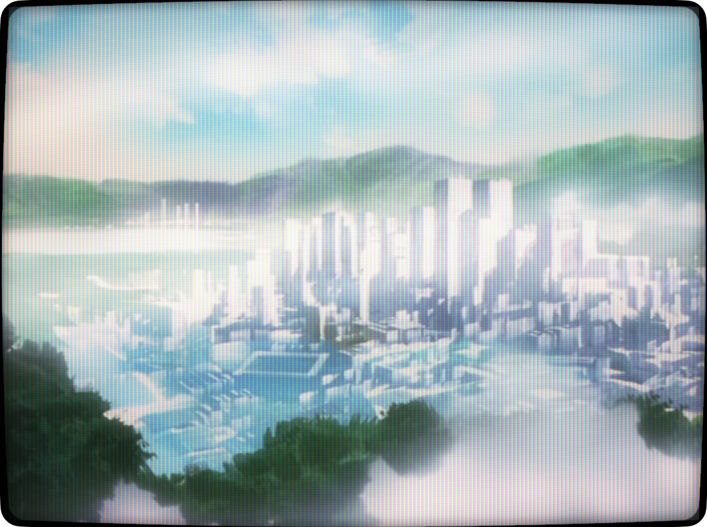
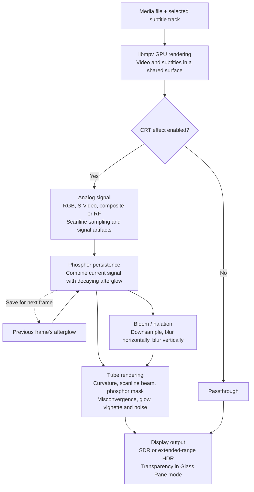

<p align="center">
  <picture>
    <source media="(prefers-color-scheme: dark)" srcset="docs/icon-dark.png">
    
  </picture>
</p>

<h1 align="center">CRT Player</h1>

<p align="center">
  A minimal macOS video player, styled after QuickTime Player, that shows every
  frame through a simulated cathode-ray tube.
</p>

<p align="center">
  
</p>

- MKV, MP4, MOV, and other libmpv-supported video and audio formats.
- Select embedded subtitle tracks or load external SRT, ASS/SSA, WebVTT, and
  bitmap subtitles from the captions button or View → Subtitles. Subtitles are
  drawn into the picture before the CRT effect, including on audio-only files.
- Edge-to-edge video in a transparent title bar. The title bar and a floating Liquid Glass
  control bar fade out while the video plays.
- Multi-pass Metal CRT shader: a choice of video signal (RGB, S-Video,
  composite with dot crawl and rainbowing, or RF with ghosting and snow),
  Gaussian scanline beam that widens with brightness, aperture-grille /
  shadow-mask / slot-mask phosphors, curved faceplate with rounded corners,
  halation and bezel glow, phosphor persistence, misconvergence, hum bar and
  grain. If there's no picture yet, it shows analog snow.
- HDR output: on displays with extended dynamic range, lit phosphors can go
  brighter than SDR white, so the mask and scanlines don't dim the picture.
- Glass Pane (⌥⌘G): the window turns into a Liquid Glass pane and the picture
  becomes light on it, so the desktop shows through the dark parts of the video,
  the scanline gaps, and the corners outside the tube.
- Float on Top (⌥⌘T): keeps the player above other apps' windows.
- Picture-tube transitions: windows power on and off like a CRT, and switching
  presets cuts through a burst of static.
- Presets: Classic (the default), Studio Monitor, Living Room TV, Arcade Cabinet,
  Green Terminal, and Amber Terminal. Every parameter can also be adjusted from
  the TV button in the control bar.

Requires macOS 26 and Xcode 26 or later.

## Build

```sh
brew install mpv pkg-config  # build dependencies
make run          # builds "build/CRT Player.app" and opens it
make demo         # same, but opens a bundled test pattern (the app's --demo flag)
make app          # just build the app bundle
make install      # builds the app and copies it to /Applications
swift run CRTPlayer   # run unbundled during development
```

Launching with nothing to open shows a dark, empty screen, and the first video
you open plays in it. Open videos with ⌘O, by dropping them on the window or
Dock icon, or with Finder's Open With menu. Playback uses libmpv, including Matroska
video (`.mkv`) and audio (`.mka`), with hardware decoding where available.
`make app` copies the playback libraries into the app, so the resulting bundle
does not require Homebrew at runtime. Build for the macOS version and architecture
you intend to run on; Homebrew bottles may require a newer macOS than the app's
minimum. Third-party notices and a library manifest are included in the bundle.

Use the captions button or View → Subtitles to choose a track or turn subtitles
off. Load Subtitle File… (⌥⌘O) attaches a subtitle file to the current player;
you can also drop one onto its window. Matching sidecar files are discovered
automatically. Track labels include available titles and languages; embedded
ASS styles and bitmap captions are rendered by libmpv. Each window has its own
subtitle selection.

Run `swift test` for playback and Metal integration tests. The small synthetic
fixtures can be regenerated with `scripts/make-test-media.sh` (requires FFmpeg).
Set `CRT_TEST_ARTIFACTS=/tmp/crt-previews` when running tests to save subtitle
images with and without the CRT effect.

## Shortcuts

| Key | Action |
| --- | --- |
| Space | Play / pause |
| ← / → | Skip 10 seconds |
| ↑ / ↓ | Volume |
| ⌥⌘O | Load subtitle file |
| ⌘E | Toggle the CRT effect |
| ⌘[ / ⌘] | Previous / next preset |
| ⌘I | CRT settings |
| ⌥⌘G | Glass Pane |
| ⌥⌘L | Loop |
| ⌥⌘T | Float on Top |
| Double-click, ⌃⌘F | Full screen |

## Simulation pipeline

The CRT effect runs as a sequence of Metal passes. The signal and afterglow
textures use the simulated tube's scanline resolution; the final pass draws
the tube at the window's resolution.



Presets and individual settings control the passes; power and preset transitions
animate their parameters. The signal pass reuses its result until the source or
settings change, except for composite, RF and no-signal snow, which animate every
frame. Two alternating afterglow textures carry phosphor persistence between
frames.

## Layout

- `Sources/CRTCore`: the renderer (`CRTRenderer`), Metal shaders, settings and presets.
- `Sources/MediaPlayback`: libmpv playback state, transport, and subtitle tracks.
- `Sources/MPVBridge`: OpenGL/IOSurface bridge from libmpv to the Metal renderer.
- `Sources/CRTPlayer`: the AppKit/SwiftUI app (document, window, controls).
- `Sources/crt-snapshot`: renders one frame through the shader to a PNG, which is
  useful for tuning AVFoundation-supported video and still images:
  `swift run crt-snapshot movie.mp4 out.png --time 5 --preset arcade`. It can also
  override the signal (`--signal composite`) or freeze a transition mid-way
  (`--transition off --at 0.3`), or preview Glass Pane over a blurred backdrop
  (`--glass wallpaper.png`).
- `Resources/AppIcon.icon`: the app icon, an Icon Composer document. Open it in
  Icon Composer to edit it; `make app` compiles it with `actool`. The README's
  `docs/icon.png` and `docs/icon-dark.png` are exported from it with Icon
  Composer's `ictool` (`--rendition Default` / `Dark`, 128×128 @2x).
