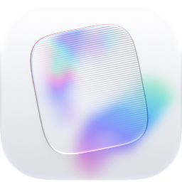
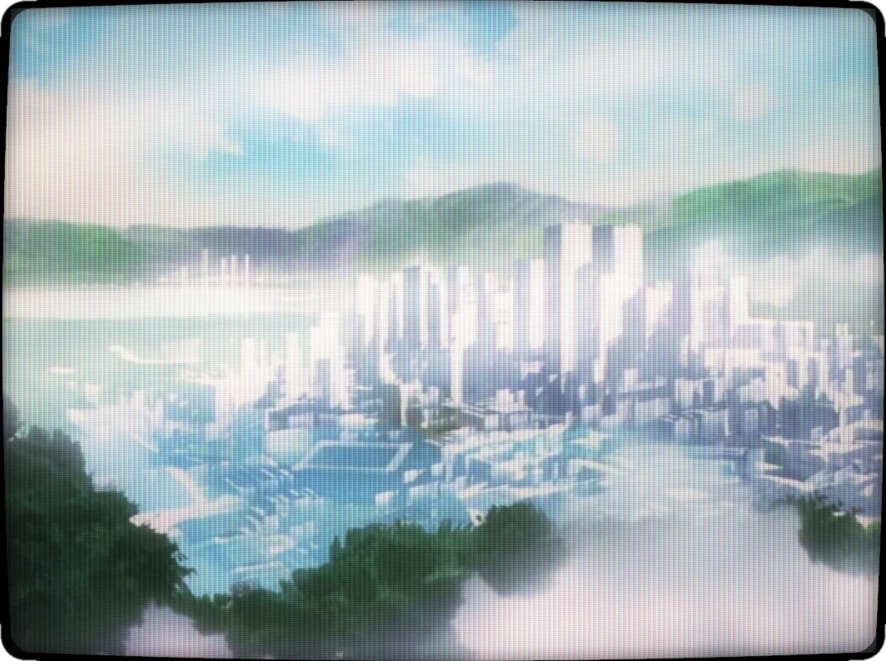
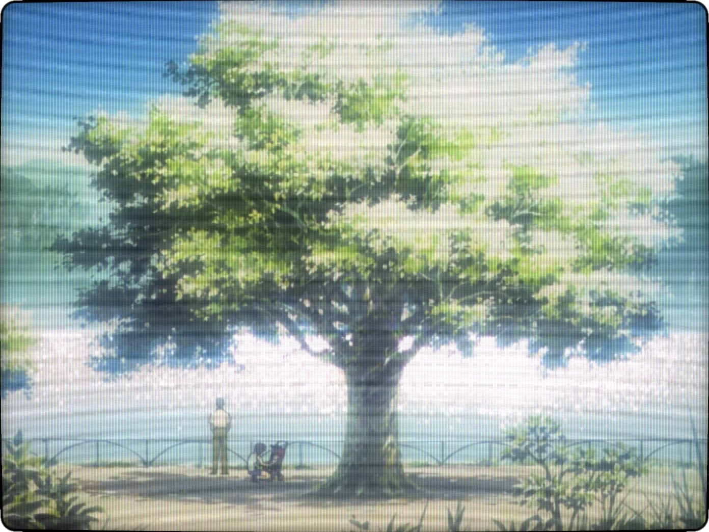
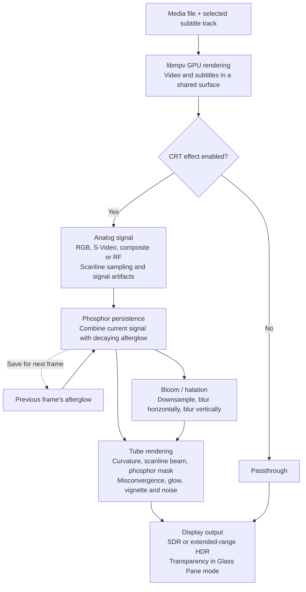

<p align="center">
  <picture>
    <source media="(prefers-color-scheme: dark)" srcset="docs/icon-dark.png">
    
  </picture>
</p>

<h1 align="center">CRT Sim</h1>

<p align="center">
  A minimal video player for macOS, iPhone, and iPad that shows every frame
  through a simulated cathode-ray tube.
</p>

<p align="center">
  
  
</p>

## Contents

- [Features](#features)
- [Requirements](#requirements)
- [Getting started](#getting-started)
- [iPhone and iPad](#iphone-and-ipad)
- [Using CRT Sim on macOS](#using-crt-sim-on-macos)
- [Keyboard shortcuts](#keyboard-shortcuts)
- [Development](#development)
- [How the simulation works](#how-the-simulation-works)
- [Project layout](#project-layout)

## Features

**Playback on macOS**

- Plays MKV, MP4, MOV, and any other video or audio format libmpv supports,
  with hardware decoding where available.
- Switches between embedded audio tracks without restarting playback.
- Shows embedded or external subtitles (SRT, ASS/SSA, WebVTT, bitmap), drawn
  into the picture *before* the CRT effect, so they look like part of the
  broadcast. Works on audio-only files too.

**CRT simulation**

- Multi-pass Metal shader with:
  - **Video signal:** RGB, S-Video, composite (with dot crawl and rainbowing),
    or RF (with ghosting and snow)
  - **Beam:** Gaussian scanlines that widen with brightness
  - **Phosphors:** aperture grille, shadow mask, or slot mask
  - **Tube:** curved faceplate with rounded corners, halation, bezel glow
  - **Imperfections:** phosphor persistence, misconvergence, hum bar, grain
- **Presets:** Classic (default), Studio Monitor, Living Room TV, Arcade
  Cabinet, Green Terminal, and Amber Terminal. Every parameter is adjustable.
- **HDR output (macOS):** on displays with extended dynamic range, lit phosphors go
  brighter than SDR white, so the mask and scanlines don't dim the picture.
- **Picture-tube transitions:** windows power on and off like a CRT, and
  switching presets cuts through a burst of static. With no picture yet, the
  screen shows analog snow.

**Window on macOS**

- Edge-to-edge video under a transparent title bar. The title bar and floating
  Liquid Glass control bar fade out during playback.
- Drag an empty area of the control bar to move it anywhere in the window.
- **Glass Pane** (⌥⌘G): the window becomes a Liquid Glass pane and the picture
  becomes light on it. The desktop shows through dark parts of the video, the
  scanline gaps, and the corners outside the tube.
- **Float on Top** (⌥⌘T): keeps the player above other apps' windows.

## Requirements

- Xcode 26 or later, with the SDK/runtime for your destination
- macOS app: macOS 26 or later; [Homebrew](https://brew.sh) packages `mpv` and
  `pkg-config` at build time
- iOS app: iOS/iPadOS 26 or later; no Homebrew or third-party playback dependencies
- A signing team in Xcode to run on a physical iPhone or iPad

Both apps use the same Metal renderer, presets, and persisted CRT settings code.
Preferences are saved locally on each device.

## Getting started

### macOS

```sh
brew install mpv pkg-config
make install
```

This builds `CRT Sim.app` and copies it to `/Applications`. The playback
libraries are bundled into the app, so it doesn't need Homebrew at runtime.

To try it without installing:

```sh
make run    # build and open the app
make demo   # build and open a bundled test pattern
```

> [!NOTE]
> Build on the macOS version and architecture you intend to run on. Homebrew
> bottles may require a newer macOS than the app's minimum.

### iOS

```sh
make ios          # unsigned simulator build
make ios-open     # open the checked-in Xcode project
make ios-test     # integration + UI tests on an available iPhone simulator
```

In Xcode, select **CRT Sim iOS**, choose an iPhone or iPad simulator, and Run.
For a physical device, set your team under **Signing & Capabilities**, choose
that device, and Run. The project references the local shared Swift package;
no project generator is needed. Keep the project inside this checkout.

To test a particular simulator:

```sh
IOS_DESTINATION='platform=iOS Simulator,name=iPad mini (A17 Pro)' make ios-test
```

## iPhone and iPad

Tap **Open Video** to choose a local or iCloud Drive file, or use another app's
**Open in CRT Sim** action. **Try Test Pattern** plays the bundled demo without
needing a media file. The app retains access to Files-provider documents for
the lifetime of playback.

Tap the picture to reveal the controls. Play/pause, skip ten seconds, or scrub
the timeline; controls fade during playback. The TV button opens all six presets
and every CRT adjustment. The power button bypasses the effect, and the **…**
menu contains loop, mute, audio tracks, and available embedded subtitle tracks.
Use the device's volume buttons to adjust volume. Video fits in portrait,
landscape, and resizable iPad windows. Playback pauses when the app becomes
inactive, and the screen stays awake while playing.

### Platform differences

| Capability | macOS | iOS / iPadOS |
| --- | --- | --- |
| Playback engine | Bundled libmpv | AVFoundation |
| File formats | MKV, MP4, MOV and other libmpv formats | Apple-supported media, including compatible MP4/MOV/M4V and audio files |
| CRT renderer and presets | Shared Metal pipeline | Same pipeline and presets |
| HDR/EDR display output | Supported | SDR output in this version |
| Audio selection | Embedded tracks, including Off | Tracks exposed by AVFoundation; mute available |
| Subtitles | Embedded/external text, ASS and bitmap, inside the CRT effect | Embedded text exposed by AVFoundation, overlaid after the CRT effect; off by default |
| Desktop window features | Glass Pane, Float on Top, multiple documents | Native full-screen player and settings sheet |

The iOS app does not bundle libmpv: MKV, external subtitle files, authored ASS
styling, and bitmap captions are not supported. Container compatibility also
depends on its codecs; unsupported files show a playback error. Picture in
Picture and background playback are not included.

## Using CRT Sim on macOS

### Opening files

Launching with nothing to open shows a dark, empty screen; the first video you
open plays in it. Open a file by any of these:

- **File → Open…** (⌘O)
- Dropping it on the window or the Dock icon
- Finder's **Open With** menu

### CRT settings

Click the **TV button** in the control bar (or press ⌘I) to pick a preset or
adjust any parameter. ⌘[ and ⌘] step through presets; ⌘E turns the effect off
and on.

### Audio tracks

Click the **waveform button** or choose **View → Audio Track** to switch
languages, commentary, or other embedded tracks.

- Tracks show title, language, codec, and channel details.
- The current track is checked; tracks marked *Default* are the file's defaults.
- **Off** disables audio entirely. The speaker button mutes without changing
  the selected track.
- Each window has its own selection. Audio-only files are supported.

### Subtitles

Click the **captions button** or choose **View → Subtitles** to pick a track or
turn subtitles off.

- **Load Subtitle File…** (⌥⌘O) attaches a file to the current player. You can
  also drop one onto the window.
- Matching sidecar files are found automatically.
- Embedded ASS styles and bitmap captions are rendered by libmpv.
- Each window has its own selection.

### Subtitle appearance

Choose **Subtitle Appearance…** from either subtitle menu to adjust size, font,
text and outline colors, bold/italic, drop shadow, and background opacity.
Changes apply immediately to every window and persist across launches.
**Reset** restores the defaults.

By default, only size changes affect ASS/SSA tracks, so their authored styling
is preserved. Enable **Override embedded styles** to apply your fonts and
colors to them too — this can alter signs and positioning. Bitmap subtitles
can't be recolored.

## Keyboard shortcuts

| Key | Action |
| --- | --- |
| Space | Play / pause |
| ← / → | Skip 10 seconds |
| ↑ / ↓ | Volume |
| ⌘O | Open file |
| ⌥⌘O | Load subtitle file |
| ⌘E | Toggle the CRT effect |
| ⌘[ / ⌘] | Previous / next preset |
| ⌘I | CRT settings |
| ⌥⌘G | Glass Pane |
| ⌥⌘L | Loop |
| ⌥⌘T | Float on Top |
| Double-click, ⌃⌘F | Full screen |

## Development

### Build commands

| Command | What it does |
| --- | --- |
| `make app` / `make macos` | Build `build/CRT Sim.app` |
| `make ios` | Build the iOS simulator app under `build/iOS` |
| `make ios-open` | Open the iOS app and test targets in Xcode |
| `make ios-test` | Run iOS playback/Metal integration and UI tests |
| `make run` | Build and open the app |
| `make demo` | Build and open a bundled test pattern (the app's `--demo` flag) |
| `make install` | Build and copy the app to `/Applications` |
| `swift run CRTPlayer` | Run unbundled during development |

**Options**

- `CONFIG=debug make app` — debug build
- `make install INSTALL_DIR="$HOME/Applications"` — choose the install directory
- `NO_COLOR=1` — disable colored output
- `make app >build.log 2>&1` — save the complete build log

Build output shows numbered stages with per-stage and total elapsed time, plus
library copy and signing progress. Long stages report progress every 10
seconds. On failure, the output names the stage and command that failed. Both
`app` and `install` verify the app's signature before reporting success.
Third-party notices and a library manifest are included in the bundle.

### Testing

```sh
swift test                                          # macOS playback and Metal integration tests
make ios-test                                       # iOS playback, Metal, and UI tests
python3 -m unittest discover -s scripts/tests -v    # build logging tests
```

- Set `CRT_TEST_ARTIFACTS=/tmp/crt-previews` to save subtitle images rendered
  with and without the CRT effect.
- iOS UI tests capture portrait, landscape, and settings screenshots in the
  Xcode test results. Playback tests cover decoding, CRT rendering, seeking,
  rotation, audio selection, replacement, and errors.
- Regenerate the small synthetic fixtures with `scripts/make-test-media.sh`
  (requires FFmpeg).

### Rendering snapshots

`crt-snapshot` renders a single frame through the shader to a PNG, which is
handy for tuning. It accepts AVFoundation-supported video and still images.

```sh
swift run crt-snapshot movie.mp4 out.png --time 5 --preset arcade
```

| Flag | Effect |
| --- | --- |
| `--signal composite` | Override the preset's signal |
| `--transition off --at 0.3` | Freeze a transition mid-way |
| `--glass wallpaper.png` | Preview Glass Pane over a blurred backdrop |

Run it without arguments for the full list of options.

## How the simulation works

Both apps use the same CRT effect, which runs as a sequence of Metal passes.
The diagram shows the macOS input path. iOS supplies pixel buffers from
`AVPlayerItemVideoOutput`, with embedded text captions overlaid separately.

The signal and afterglow textures use the simulated tube's scanline resolution; the final pass draws
the tube at the window's resolution.



- Presets and individual settings control the passes; power and preset
  transitions animate their parameters.
- The signal pass reuses its result until the source or settings change.
  Composite, RF, and no-signal snow are the exception — they animate every frame.
- Two alternating afterglow textures carry phosphor persistence between frames.

## Project layout

| Path | Contents |
| --- | --- |
| `Apps/macOS/CRTPlayer` | AppKit/SwiftUI document app, windows, and desktop controls |
| `Apps/macOS/MediaPlayback` | libmpv transport and audio/subtitle tracks |
| `Apps/macOS/MPVBridge`, `Apps/macOS/CMpv` | macOS OpenGL/IOSurface bridge and libmpv bindings |
| `Apps/iOS/CRTPlayer` | SwiftUI player, AVFoundation playback, UIKit Metal surface, and settings sheet |
| `Apps/iOS/CRTPlayer.xcodeproj` | Checked-in iPhone/iPad app, integration tests, UI tests, and shared scheme |
| `Shared/CRTCore` | Metal renderer, shaders, settings value types, and presets |
| `Shared/CRTPreferences` | Persisted CRT preferences; desktop-only preferences are compiled only on macOS |
| `Tools/crt-snapshot` | macOS command-line single-frame renderer |
| `Tests/macOS`, `Tests/iOS` | Platform-specific integration tests and iOS UI tests |
| `Tests/Fixtures` | Synthetic media shared by both platforms’ playback tests |
| `Resources` | Shared test-pattern movie and Icon Composer app icon |
| `scripts` | Platform build entry points, shared progress reporting, and media fixture generation |

The root `Package.swift` exports `CRTCore` and `CRTPreferences` for the iOS
project. Its desktop-only targets remain available to SwiftPM on macOS; the iOS
app depends only on the shared libraries. Keep AppKit, libmpv, and OpenGL code in
`Apps/macOS`, AVFoundation playback and UIKit code in `Apps/iOS`, and reusable
rendering code in `Shared`.

**Editing the icon:** open `Resources/AppIcon.icon` in Icon Composer. `make app`
compiles it with `actool`. The README's `docs/icon.png` and `docs/icon-dark.png`
are exported from it with Icon Composer's `ictool` (`--rendition Default` /
`Dark`, 128×128 @2x).

## License

[MIT](LICENSE)
